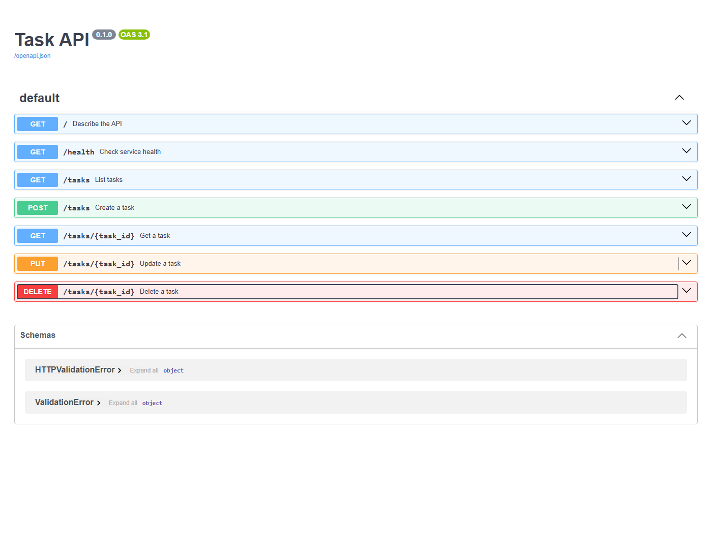

# Task API — final stage-verified reconstruction

This is the third public reconstruction of A1 from earlier AI-assisted work. It corrects the previous rebuild's Stage 1 sequencing issue by checking exact root metadata before its Stage 1 commit. Both prior public repositories and all other assignments remain unchanged. This is AI-assisted work, not a claim of hand-written authorship. Current-time commits follow the required stages, each gated by actual runtime checks.

